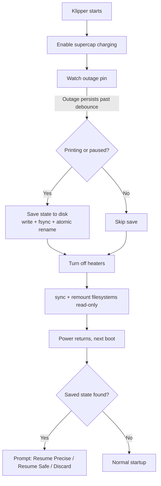

# Elegoo Centauri Carbon Power-Loss Recovery for Klipper (CC1 & CC2)

# This is a work-in-progress. It does not work with any printers using CANVAS. I have to figure that out!!


Power-loss recovery for the Elegoo Centauri Carbon 1 (CC1) and Centauri Carbon 2 (CC2) running COSMOS firmware and Klipper.

This project provides a custom Klipper power_loss module and installer that detect a mains power outage, save the current print state when possible, and offer print recovery after power is restored.

## Features
- Power-loss detection: Monitors the printer's power-outage sensor using GPIO.
- Print-state preservation: Saves relevant print information when a print is running or paused.
- Recovery options: Provides options to resume a saved print or discard the saved state.
- COSMOS integration: Installs the Klipper module using an overlay mount to accommodate the firmware's read-only filesystem.
- Multiple printer profiles: Includes separate configuration defaults for the Centauri Carbon 1 and Centauri Carbon 2.
- Safety checks: Tests at startup that the state file location is writable, so a bad path or read-only mount is reported before an outage, not after.
- Installer, update and removal support: Includes an installer with model selection, configuration options, an update procedure, and an uninstall procedure.

> [!IMPORTANT]
> **Original author: [jagonmo](https://gist.github.com/jagonmo).** This project is a derivative of jagonmo's [`power_loss` module](https://gist.github.com/jagonmo/b14d6420d6d4af3de0ad6a0cdce5524c). jagonmo reverse engineered Elegoo's firmware, found the pins, designed the module, and proved it end to end with a real power cut on a Centauri Carbon 1. Nearly everything here builds on that work. See [Credits](#credits-and-license) for details.

## Compatibility
| Model                    | Status                                                                                           |
| ------------------------ | ------------------------------------------------------------------------------------------------ |
| Centauri Carbon 1 (CC1)  | Built-in defaults (`printer_model: cc1`).                                                        |
| Centauri Carbon 2 (CC2)  | COSMOS for the CC2 is in alpha. Defaults from Elegoo's official config (`printer_model: cc2`). The outage sensor is confirmed by an unplug test on a real CC2; the charge pin is not independently verified. See [Centauri Carbon 2](#centauri-carbon-2). |

> [!WARNING]
> This module is experimental and has not been validated across printers or hardware revisions. Test it with a print you don't care about before relying on it. See [Known limitations](#known-limitations).

## Quick start

1. **Install COSMOS** on your printer: [CC1](#auto-installing-on-the-centauri-carbon-1) or [CC2 (alpha)](#auto-installing-on-the-centauri-carbon-2).
2. **SSH into the printer** ([details](#connecting-over-ssh)) and run the installer:

   ```sh
   curl -fsSL https://raw.githubusercontent.com/peepsnet/CentauriCarbon-1-2-PowerLoss-Script/main/install.sh | sh
   ```

3. **Paste the `[power_loss]` section** it prints into `printer.cfg` in the web interface, then run `RESTART` in the console. See [Add the config and restart Klipper](#add-the-config-and-restart-klipper).
4. **Run `POWER_LOSS_STATUS`.** After about 30 seconds it should show `charge_done=True` and `save_path_writable=True`.
5. **Test it** before trusting it with a real print: [Testing recovery safely](#testing-recovery-safely).

To keep it current, see [Update](#update).

## Table of contents

- [How it works](#how-it-works)
- [Hardware](#hardware)
- [Centauri Carbon 1](#centauri-carbon-1)
- [Centauri Carbon 2](#centauri-carbon-2)
- [Installation](#installation)
    - [Connecting over SSH](#connecting-over-ssh)
    - [Auto installing on the Centauri Carbon 1](#auto-installing-on-the-centauri-carbon-1)
    - [Auto installing on the Centauri Carbon 2](#auto-installing-on-the-centauri-carbon-2)
    - [Running the installer](#running-the-installer)
    - [What the installer does](#what-the-installer-does)
    - [Options](#options)
    - [Manual install](#manual-install)
    - [Add the config and restart Klipper](#add-the-config-and-restart-klipper)
    - [Update](#update)
    - [Uninstall](#uninstall)
- [Configuration](#configuration)
- [Commands](#commands)
- [Detection methods](#detection-methods)
- [Usage](#usage)
    - [Resume Precise vs. Resume Safe](#resume-precise-vs-resume-safe)
    - [Before you resume](#before-you-resume)
    - [Testing recovery safely](#testing-recovery-safely)
- [Resume sequence](#resume-sequence)
- [What gets saved](#what-gets-saved)
- [Known limitations](#known-limitations)
- [Troubleshooting](#troubleshooting)
- [Reporting problems](#reporting-problems)
- [Resources](#resources)
- [Credits and license](#credits-and-license)

## How it works



1. **Checks and charges.** At startup it tests that the state file location is writable and enables supercap charging.
2. **Detects** an outage on a dedicated GPIO pin, using edge events with a polling fallback, and debounces it so a brief flicker doesn't trigger a save.
3. **Saves** position, temperatures, fan, speed and file offset to disk. This only happens if a print is running or paused.
4. **Protects** the filesystems by running `sync` and remounting writable ext*/FAT mounts read-only. It does not shut the system down.
5. **Offers a resume** on the next boot through a Mainsail/Fluidd prompt.

> [!NOTE]
> This is not a UPS. The supercapacitor only keeps the board alive for a few seconds, which is just long enough to save the state. Motors and heaters are not kept running, and the print stops the moment mains power is lost.

## Hardware

Pins for each model (the `printer_model` defaults):

| Function                       | CC1 port | CC1 GPIO | CC2 port | CC2 GPIO | Used by this module |
| ------------------------------ | -------- | -------- | -------- | -------- | ------------------- |
| Outage detection               | PG0      | 192      | PG9      | 201      | Input (read)        |
| Supercap charge enable         | PC1      | 65       | PD20     | 116      | Output (control)    |
| Supercap output to power rail  | PG11     | 203      | PG11     | 203      | **Never used**      |

Linux GPIO numbers use the Allwinner rule `32 × (port letter index, A=0) + pin`. That reproduces all three CC1 numbers, and the CC2 numbers are derived the same way. The CC2 port names come from the `[por]` section of Elegoo's `printer_dsp.cfg`.

> [!IMPORTANT]
> The "supercap output to rail" line connects the supercap to the power rail. The module refuses to start if the configured `rail_gpio` is also used as the sensor or charge pin. On both CC1 and CC2 that is GPIO 203 and is guarded by default. Don't remove that guard without checking with a multimeter what is on the other side.

jagonmo reported this from a real outage test on a CC1 with mains fully unplugged: with the supercap charged, the SoC stayed alive for roughly 5–15 seconds. Whether motors and heaters keep any residual power is **unconfirmed**, so the module assumes they don't and only moves the toolhead on resume.

## Centauri Carbon 1

`printer_model: cc1` is the default, so on a CC1 you don't have to set the model at all. The module uses these defaults:

```ini
[power_loss]
printer_model: cc1
sensor_gpio: 192      # PG0
charge_gpio: 65       # PC1
rail_gpio: 203        # PG11, guarded and never driven
```

> [!IMPORTANT]
> These settings need to be added to `printer.cfg` through the web interface.

**Where the numbers come from.** The CC1 is the printer the original module was written for. The pins come from Elegoo's official CC1 firmware sources (`gpio.h` and `por.cpp`), as worked out in [jagonmo's original module](https://gist.github.com/jagonmo/b14d6420d6d4af3de0ad6a0cdce5524c). The ports convert to Linux GPIO numbers with the standard Allwinner formula, `32 × (port letter index, A=0) + pin`: PG0 is 32 × 6 + 0 = 192, PC1 is 32 × 2 + 1 = 65, and PG11 is 32 × 6 + 11 = 203. The same pin table was posted in [OpenCentauri/cosmos issue 348](https://github.com/OpenCentauri/cosmos/issues/348).

> [!NOTE]
> Unlike the CC2 defaults, the CC1 pins were confirmed on real hardware by the original author, so you don't need to re-derive them. You should still verify the module on your own printer before trusting it with a long print:
> 1. Run `POWER_LOSS_STATUS` and check that it shows `model=cc1 sensor=GPIO192 charge=GPIO65 rail_guard=203` and `save_path_writable=True`. After about 30 seconds `charge_done` should become `True`.
> 2. Run `POWER_LOSS_TEST_READ N=100` with mains on. The readings should be all `0`. The default polarity is that `1` means an outage.
> 3. With the printer idle, unplug mains for about 10 seconds and check `klippy.log` for `power_loss: OUTAGE DETECTED`.
> 4. Only then do a controlled test with a print you don't care about. See [Testing recovery safely](#testing-recovery-safely).

### CC1 test status

- **Original author's test.** jagonmo ran the original module on a real CC1 running COSMOS with mains fully unplugged. With the supercap charged, the SoC stayed alive for roughly 5–15 seconds.
- **This version.** The hardware results listed in this README for this version (the debounce, atomic save, model profiles and installer) come from a CC2. No CC1 results have been reported for it yet, so treat the CC1 path as limited-tested until they are.

What the `cc1` profile sets up that the other models don't:

- **Tray macro and wipe.** `tray_macro` defaults to `MOVE_TO_TRAY`, and the built-in wipe pattern is on. The wipe uses fixed CC1 coordinates, which is why it is only allowed with `printer_model: cc1`. Set `wipe: False` to skip it, or point `tray_macro` at your own sequence.
- **`homing_override_z_lift`.** The default of `5.0` matches the Z lift in the COSMOS `[homing_override]` that the original was written against. If you changed that macro, update this value to match, or the resumed Z height will be wrong.
- **COSMOS status.** COSMOS on the CC1 is described by its docs as stable enough for everyday printing but still actively developed, and it warns that the stock mainboard has very little spare resource (see [Stability and memory](https://docs.opencentauri.cc/klipper-conversion/cosmos/troubleshooting/stability/)). Read the [release changelogs](https://github.com/OpenCentauri/cosmos/releases) before updating COSMOS, because an update can overwrite the init script change the installer makes.

If you test this on a CC1 (or find that something doesn't match), please open an issue or PR so this section can record it.

## Centauri Carbon 2

With `printer_model: cc2` the module uses these defaults:

```ini
[power_loss]
printer_model: cc2
sensor_gpio: 201      # PG9
charge_gpio: 116      # PD20
rail_gpio: 203        # PG11, guarded and never driven
```

> [!IMPORTANT]
> These settings need to be added to `printer.cfg` through the web interface.

**Where the numbers come from.** Elegoo's official CC2 config (`debugfile/printer_dsp.cfg` in `elegooofficial/CentauriCarbon2`) has a `[por]` section with `sensor_pin=host:PG9`, `ctrl_pin=host:PG11`, `charge_pin=host:PD20` and `charge_time=30.0`. The same pin table was posted in [OpenCentauri/cosmos issue 348](https://github.com/OpenCentauri/cosmos/issues/348). The conversion to Linux GPIO numbers uses the standard Allwinner formula, which matches the CC1's known values. It assumes the CC2 uses the same SoC pin numbering. A hardware test on one CC2 (below) supports that for the outage sensor.

> [!NOTE]
> The CC2 numbers come from Elegoo's config, and only the outage sensor has been confirmed on hardware. On startup the module logs a warning for `cc2`. Before trusting a save:
> 1. Run `POWER_LOSS_STATUS` and `cat /sys/kernel/debug/gpio` (if debugfs is mounted) and check that the lines are named or behave as expected. `POWER_LOSS_STATUS` should also show `save_path_writable=True`.
> 2. Run `POWER_LOSS_TEST_READ N=100` with mains on. If the readings are all `1`, the sensor polarity is probably opposite to the CC1 and you need `invert_sensor: True`. The official config does not state the polarity.
> 3. Only then do a controlled test with a print you don't care about. See [Testing recovery safely](#testing-recovery-safely).

### Hardware test results

One tester ran this on a CC2 (alpha COSMOS, installed as described in [Auto installing on the Centauri Carbon 2](#auto-installing-on-the-centauri-carbon-2)) with the default `cc2` profile:

- `POWER_LOSS_STATUS` reported `model=cc2 sensor=GPIO201 charge=GPIO116 rail_guard=203`, and `charge_done` became `True` after about 30 seconds. Detection ran in `polling` mode.
- With mains on, `POWER_LOSS_TEST_READ N=100` returned 100 zeros, so the default polarity (1 means outage) is right and `invert_sensor` isn't needed.
- With the printer idle, unplugging mains for about 10 seconds produced `OUTAGE DETECTED`, `not printing, skipping state save`, and read-only remounts of `/data`, `/user-resource`, `/board-resource`, `/opt/usr` and the USB stick. The system logged a normal Stats line afterwards.

That confirms the sensor pin, polarity and the outage handler. Still **untested on a CC2**: saving state during a real print and a full resume, and whether the charge pin (GPIO 116) is what keeps the board alive. The printer was idle, so no state was written.

Differences from `cc1`:

- **No tray macro or wipe by default.** `tray_macro` is blank and the built-in wipe pattern is disabled. The wipe uses CC1 coordinates, so it is rejected for any model other than `cc1`. If `tray_macro` is blank, the resume skips the purge entirely rather than purging over the part. Point `tray_macro` at your own parking macro if you want a purge.
- **Re-check `homing_override_z_lift`.** It must match the Z lift in your CC2's `[homing_override]`.
- **COSMOS for the CC2 is in alpha.** The module loaded and read its GPIOs on a tested CC2 running that build, so sysfs access works there, but alpha firmware can change between releases. Elegoo's CC2 config shows a different architecture from the CC1 (a separate DSP core running the motion MCU), so check the [COSMOS docs](https://docs.opencentauri.cc/klipper-conversion/cosmos/cosmos/), the CC2 [hardware pages](https://docs.opencentauri.cc/hardware/CC2/) and the [alpha announcement](https://discord.com/channels/1367538416539013122/1558535377344659488/1558535377344659488) for what your build supports.

Use `printer_model: custom` for any other board. It has no GPIO defaults, so you must set `sensor_gpio` and `charge_gpio` yourself, and `rail_gpio` too so the rail line is guarded.

If you confirm the CC2 behavior on real hardware (or find that a number is wrong), please open an issue or PR so the defaults can be corrected.

## Installation

COSMOS's root filesystem is read-only, so the module is installed through an overlay mount over Klipper's `extras` directory. The installer does this for you, but you run it **on the printer itself, over SSH**. It is not something you run on your computer.

### Connecting over SSH

From a terminal on your computer, replace `<printer-ip>` with the printer's IP address (from your router's device list or the printer's network settings):

```sh
ssh root@<printer-ip>
```

The first time you connect, SSH asks you to accept the printer's host key. Type `yes`. macOS and Linux have `ssh` in the terminal, Windows 10 and later have it in PowerShell and Windows Terminal, and PuTTY also works.

| Printer                  | User   | Password        | Source                                                                                      |
| ------------------------ | ------ | --------------- | ------------------------------------------------------------------------------------------- |
| CC1 (COSMOS)             | `root` | `OpenCentauri`  | OpenCentauri docs for the patched firmware, the cc-fw-tools README, and third-party COSMOS add-ons. The COSMOS install guide doesn't state it. |
| CC2 (COSMOS alpha)       | `root` | none            | OpenCentauri's CC2 alpha announcement.                                                      |

> [!WARNING]
> Both are open or well-known logins, so anyone on your network can log in as root. Don't expose the printer's SSH port to the internet. Consider switching to key-based login with `ssh-copy-id root@<printer-ip>`, which the OpenCentauri firmware tools README recommends, and use `passwd` on the printer to set a password.

If SSH says `Permission denied`, the password is wrong or the login has changed on your version, so check the COSMOS docs or ask on the OpenCentauri Discord. If it says `Connection refused` or times out, check the IP address and that the printer is on your network.

Follow the section for your printer:

- [Auto installing on the Centauri Carbon 1](#auto-installing-on-the-centauri-carbon-1): COSMOS is installed with the standard OpenCentauri method.
- [Auto installing on the Centauri Carbon 2](#auto-installing-on-the-centauri-carbon-2): COSMOS for the CC2 is in alpha testing, so the install is different and riskier.

Both sections end with the same two shared steps, described after them: [running the installer](#running-the-installer) and [adding the config](#add-the-config-and-restart-klipper).

### Auto installing on the Centauri Carbon 1

COSMOS on the CC1 is installed with the OpenCentauri installer, as described on the OpenCentauri website. This module goes on top of a working COSMOS install.

**You need:** a CC1 running COSMOS, the printer on your network (and its IP address), an SSH client, and no print running.

1. **Install COSMOS Firmware.** Follow the official [CC1 COSMOS install guide](https://docs.opencentauri.cc/klipper-conversion/cosmos/install/).
2. **Connect over SSH** as `root` with the password `OpenCentauri`. See [Connecting over SSH](#connecting-over-ssh).
3. **Run the installer** from the SSH session. See [Running the installer](#running-the-installer):

   ```sh
   curl -fsSL https://raw.githubusercontent.com/peepsnet/CentauriCarbon-1-2-PowerLoss-Script/main/install.sh | sh
   ```

   Or, to bypass the script's automatic printer detection and specify the CC1, use:

   ```sh
   curl -fsSL https://raw.githubusercontent.com/peepsnet/CentauriCarbon-1-2-PowerLoss-Script/main/install.sh | sh -s -- --model cc1
   ```

4. **Add the config and restart Klipper.** Paste a `[power_loss]` section with `printer_model: cc1` into `printer.cfg` and run `RESTART`. See [Add the config and restart Klipper](#add-the-config-and-restart-klipper).

### Auto installing on the Centauri Carbon 2

> [!IMPORTANT]
> COSMOS for the CC2 is an early **technical preview in alpha testing** at the time of writing.
> **Recovering from a failed install needs a 3.3 V logic-level USB UART adapter** (for example one based on a CP2101, PL2303 or FT232 chip). Don't start without one.
> This applies to the **CC2 and CC2C only**; the C2 and C2C aren't supported.
> To install COSMOS on your CC2, follow the steps in OpenCentauri's alpha announcement on their Discord: [announcement](https://discord.com/channels/1367538416539013122/1558535377344659488/1558535377344659488).
> That post is the source of truth and may have changed, so read it before you begin and report what you run into, good and bad.
> I used this method on my CC2.

**You need:** a CC2 or CC2C running the alpha COSMOS build, the printer on your network (and its IP address), an SSH client, and no print running.

1. **Install COSMOS Firmware (alpha).** Follow the steps in the [alpha announcement](https://discord.com/channels/1367538416539013122/1558535377344659488/1558535377344659488). Once the printer is running the updated COSMOS, continue with step 2.
2. **Connect over SSH** as `root` and leave the password blank. See [Connecting over SSH](#connecting-over-ssh).
3. **Run the installer** from the SSH session. See [Running the installer](#running-the-installer):

   ```sh
   curl -fsSL https://raw.githubusercontent.com/peepsnet/CentauriCarbon-1-2-PowerLoss-Script/main/install.sh | sh
   ```

   Or, to bypass the script's automatic printer detection and specify the CC2, use:

   ```sh
   curl -fsSL https://raw.githubusercontent.com/peepsnet/CentauriCarbon-1-2-PowerLoss-Script/main/install.sh | sh -s -- --model cc2
   ```

4. **Add the config and restart Klipper.** Paste a `[power_loss]` section with `printer_model: cc2` into `printer.cfg` and run `RESTART`. See [Add the config and restart Klipper](#add-the-config-and-restart-klipper).
5. **Verify the sensor** before trusting a save. The CC2 pin defaults are only partly tested, so read the [Centauri Carbon 2](#centauri-carbon-2) section first.

### Running the installer

Run this in your SSH session on the printer. It is the same for both models.

#### One-line install

To pin a specific release, replace `main` with a tag or commit:

```sh
curl -fsSL https://raw.githubusercontent.com/peepsnet/CentauriCarbon-1-2-PowerLoss-Script/main/install.sh | sh
```

To pass options, such as the model, use `sh -s --`:

```sh
curl -fsSL https://raw.githubusercontent.com/peepsnet/CentauriCarbon-1-2-PowerLoss-Script/main/install.sh | sh -s -- --model cc2
```

> [!NOTE]
> This needs the printer to have internet access and either `curl` or `wget`. If it doesn't, use [Copy the files over](#copy-the-files-over-no-internet-on-the-printer) below. Piping a script into `sh` runs whatever is at that URL. If you'd rather read it first, download `install.sh`, open it, then run `sh install.sh`.

#### Copy the files over (no internet on the printer)

Download `install.sh` and `power_loss.py` to a folder on your computer, then from that folder:

```sh
scp install.sh power_loss.py root@<printer-ip>:/tmp/
ssh root@<printer-ip>
sh /tmp/install.sh
```

The installer uses the `power_loss.py` sitting next to it instead of downloading one. If `scp` fails with an SFTP-related error, add `-O` (`scp -O ...`). If `/tmp` isn't usable, any writable directory such as `/user-resource` works.

### What the installer does

1. **Checks** that it's running as root, that the Klipper `extras` directory exists, and that the kernel supports overlayfs.
2. **Identifies your printer.** It looks at system identification strings (device-tree model, hostname, OS release) and, as a weaker signal, at printer configs that reference a DSP rpmsg MCU (CC2 style). It always shows what it found and asks you to confirm. If it can't tell, it shows a menu: CC1, CC2 or custom. For a custom board it asks for the three GPIO numbers.
3. **Downloads** `power_loss.py`, checks that it looks like the module and compiles, and verifies a SHA-256 if you supplied one.
4. **Checks that `/data` is writable**, then copies the module into `/data/klipper-extras-upper` and mounts the overlay. On a re-run (an update) it writes through the already-mounted overlay instead.
5. **Persists the mount** by adding a marked block to `/etc/init.d/klipper`, after backing it up to `/etc/init.d/klipper.bak-power_loss`. If it can't find a `start)` block, or the file can't be written, it leaves the file alone and prints the block for you to add.
6. **Prints the `[power_loss]` section** for your model, or appends it to a file you name with `--printer-cfg`, after backing that file up.

It never restarts Klipper, because that would interrupt a print. Restart it yourself when the printer is idle.

> [!IMPORTANT]
> Detection is a best guess and the identification strings haven't been verified on real CC1 or CC2 units. That's why it always asks for confirmation. Check the model it picks before you accept it.

### Options

| Option                      | Description                                                                                          |
| --------------------------- | ---------------------------------------------------------------------------------------------------- |
| `--model cc1\|cc2\|custom`    | Skip detection and prompts.                                                                          |
| `--sensor N --charge N --rail N` | Linux GPIO numbers for `--model custom`. The rail line is guarded and never driven.            |
| `--printer-cfg PATH`        | Append the `[power_loss]` section to this file. It is skipped if the file already has one. Pasting it into `printer.cfg` in the web interface works just as well. |
| `--yes`, `-y`               | Accept the detected model without asking. It fails if nothing could be detected.                     |
| `--no-persist`              | Don't patch the init script. The mount then lasts until the next reboot.                             |
| `--uninstall`               | Remove the module, the init patch and the overlay. The saved state file and your `printer.cfg` are left alone. |
| `--no-mount`                | Copy and patch files only, with no mount and no root check. Intended for testing.                    |

| Environment variable   | Description                                                      |
| ---------------------- | ---------------------------------------------------------------- |
| `POWER_LOSS_REPO`      | `owner/name` of the repository to download from. Defaults to `peepsnet/CentauriCarbon-1-2-PowerLoss-Script`. |
| `POWER_LOSS_REF`       | Branch, tag or commit to download. Defaults to `main`.           |
| `POWER_LOSS_SHA256`    | Require this checksum for `power_loss.py`.                       |

Non-interactive example (for example over SSH with no terminal), using a pinned tag and a checksum:

```sh
curl -fsSL https://raw.githubusercontent.com/peepsnet/CentauriCarbon-1-2-PowerLoss-Script/v1.0.0/install.sh | \
  POWER_LOSS_REPO=peepsnet/CentauriCarbon-1-2-PowerLoss-Script POWER_LOSS_REF=v1.0.0 POWER_LOSS_SHA256=<sha256> \
  sh -s -- --model cc1 --printer-cfg /path/to/printer.cfg
```

> [!NOTE]
> A COSMOS update may overwrite `/etc/init.d/klipper`. Check it after every update and re-run the installer if the block is gone. Re-running is safe: every step skips what is already done.

### Manual install

If you'd rather not use the script:

```sh
mkdir -p /data/klipper-extras-upper /data/klipper-extras-work
cp power_loss.py /data/klipper-extras-upper/power_loss.py

mount -t overlay klipper-extras-overlay \
    -o lowerdir=/usr/share/klipper/klippy/extras,upperdir=/data/klipper-extras-upper,workdir=/data/klipper-extras-work \
    /usr/share/klipper/klippy/extras
```

To make it permanent, add this inside the `start)` block of `/etc/init.d/klipper`, before the `start-stop-daemon` line:

```sh
if ! grep -q '^klipper-extras-overlay ' /proc/mounts; then
    mount -t overlay klipper-extras-overlay \
        -o lowerdir=/usr/share/klipper/klippy/extras,upperdir=/data/klipper-extras-upper,workdir=/data/klipper-extras-work \
        /usr/share/klipper/klippy/extras
fi
```

### Add the config and restart Klipper

Add the `[power_loss]` section the installer printed (see [Configuration](#configuration) for every option) to `printer.cfg`. The COSMOS docs say `printer.cfg` is the user-facing config and can be edited in the web interface, so the easiest way is to paste the section there. Don't put it in `klipper-readonly/*.cfg`: COSMOS resets those files on every firmware update (see [COSMOS: Features](https://docs.opencentauri.cc/klipper-conversion/cosmos/features/)).

<details><summary><b>CC1 minimal printer.cfg entry</b></summary>

```ini
[power_loss]
printer_model: cc1
save_path: /data/power_loss_state.json
# Must match the Z lift in your [homing_override]:
homing_override_z_lift: 5.0
```

</details>

<details><summary><b>CC2 minimal printer.cfg entry</b></summary>

```ini
[power_loss]
printer_model: cc2
save_path: /data/power_loss_state.json
# Must match the Z lift in your [homing_override]:
homing_override_z_lift: 5.0
```

</details>

Then restart Klipper while no print is running, by running this in the web interface's console:

```
RESTART
```

If the module doesn't load, restart the whole printer with `REBOOT_MACHINE` in the console, or run `reboot` over SSH. The installer's overlay mount is set up at boot, so a reboot also confirms that it persists.

#### Verify

In the Mainsail/Fluidd console run:

```
POWER_LOSS_STATUS
```

After about 30 seconds it should report `charge_done=True` and `save_path_writable=True`, and show which `detection=` method is active. If it reports `save_path_writable=False`, the state file couldn't be written to `save_path`. Fix the path or mount and run `POWER_LOSS_STATUS RECHECK=1`.

### Update

Updating means re-running the installer and then restarting Klipper. Re-running is safe: the installer skips what's already done (the overlay mount and the init script patch), and it never changes your `printer.cfg`.

> [!IMPORTANT]
> Before you update:
> - **No print running.** Restarting Klipper cancels a print in progress.
> - **Resume or discard any saved print first.** The saved-state format can change between versions. Run `POWER_LOSS_STATUS` and check that it shows `pending_resume=False`. If it shows `True`, use `POWER_LOSS_RESUME_SAFE` or `POWER_LOSS_DISCARD` first.

#### Update the module

1. **Connect over SSH.** See [Connecting over SSH](#connecting-over-ssh).
2. **Re-run the installer.** This is the same command you used to install. See [Running the installer](#running-the-installer):

   ```sh
   curl -fsSL https://raw.githubusercontent.com/peepsnet/CentauriCarbon-1-2-PowerLoss-Script/main/install.sh | sh
   ```

   Add `-s -- --model cc1` (or `cc2`) after `sh` to skip the model prompt. A normal update prints `Updated module through the mounted overlay` and `Overlay already mounted`. It also prints the `[power_loss]` config snippet again. Ignore that if you already have the section in `printer.cfg`.

   **No internet on the printer?** Download the new `install.sh` and `power_loss.py` to your computer, then run `scp install.sh power_loss.py root@<printer-ip>:/tmp/` and, on the printer, `sh /tmp/install.sh`.
3. **Restart Klipper** so the new module loads. The old version keeps running until you do. Run this in the web interface's console, with no print running:

   ```
   RESTART
   ```

4. **Check the result.** Run `POWER_LOSS_STATUS` and confirm the model, pins and `save_path_writable=True`. Then read the release notes or commit history for new or renamed options, and edit `printer.cfg` in the web interface if needed. See [Configuration](#configuration).

The module has no version command. To confirm which file is installed, compare its checksum with the one in the repo:

```sh
sha256sum /usr/share/klipper/klippy/extras/power_loss.py
curl -fsSL https://raw.githubusercontent.com/peepsnet/CentauriCarbon-1-2-PowerLoss-Script/main/power_loss.py | sha256sum
```

The two checksums should match.

To install a specific release instead of the latest `main`, pin a tag or commit with `POWER_LOSS_REF`. Tags exist only if the repository has published them:

```sh
curl -fsSL https://raw.githubusercontent.com/peepsnet/CentauriCarbon-1-2-PowerLoss-Script/v1.0.0/install.sh | \
  POWER_LOSS_REF=v1.0.0 sh
```

#### After a COSMOS update

A COSMOS update can overwrite `/etc/init.d/klipper`, which holds the line that re-mounts the overlay at boot. After any COSMOS update, check that the module is still in place:

```sh
grep -c power_loss-overlay-begin /etc/init.d/klipper   # 1 means the init script is still patched
grep klipper-extras-overlay /proc/mounts               # should print one line
```

Then run `POWER_LOSS_STATUS` in the console. If either check fails, or the console says `Unknown command: POWER_LOSS_STATUS`, re-run the installer and then reboot the printer:

```sh
curl -fsSL https://raw.githubusercontent.com/peepsnet/CentauriCarbon-1-2-PowerLoss-Script/main/install.sh | sh
reboot
```

Also check that the `[power_loss]` section is still in `printer.cfg`. To update COSMOS itself, follow the [COSMOS install guide](https://docs.opencentauri.cc/klipper-conversion/cosmos/install/). On the CC2 alpha, update from the machine tab in the web interface as described in the [alpha announcement](https://discord.com/channels/1367538416539013122/1558535377344659488/1558535377344659488).

#### Roll back to an older version

Re-run the installer pinned to the older tag or commit, then run `RESTART`:

```sh
curl -fsSL https://raw.githubusercontent.com/peepsnet/CentauriCarbon-1-2-PowerLoss-Script/<tag-or-commit>/install.sh | \
  POWER_LOSS_REF=<tag-or-commit> sh
```

If the newer version added options to your `[power_loss]` section, remove them first. Klipper refuses to start when a section contains an option it doesn't recognize.

#### If Klipper won't start after an update

1. In the web interface's config editor, comment out the whole `[power_loss]` section in `printer.cfg` (put a `#` at the start of each line), then restart Klipper.
2. Read the error in the console or `klippy.log`. It will usually name an unknown or invalid option.
3. Fix or remove the option, then un-comment the section. If the module itself is the problem, remove it with the [uninstall](#uninstall) steps and report the error in an issue. For recovering a broken COSMOS config, see [COSMOS: Troubleshooting, Configuration and recovery](https://docs.opencentauri.cc/klipper-conversion/cosmos/troubleshooting/recovery/).

### Uninstall

```sh
curl -fsSL https://raw.githubusercontent.com/peepsnet/CentauriCarbon-1-2-PowerLoss-Script/main/install.sh | sh -s -- --uninstall
```

This removes the module, the init script patch and the overlay mount. It leaves your `printer.cfg` and any saved state file (for example `/data/power_loss_state.json`) alone. Then:

1. **Remove the `[power_loss]` section from `printer.cfg`** in the web interface. Klipper refuses to start if the section is still there but the module is gone.
2. Restart Klipper with `RESTART` while no print is running.

## Configuration
Every option has a default on `cc1`. `cc2` has pin defaults from Elegoo's config, and `custom` has none, so you must set the GPIO options. Only declare the options you want to change.

| Option                   | Default                          | Description                                                                                  |
| ------------------------ | ----------------------------- | -------------------------------------------------------------------------------------------- |
| `printer_model`          | `cc1`                         | `cc1`, `cc2` or `custom`. Selects the defaults below. `custom` has no GPIO defaults. |
| `sensor_gpio`            | `192` on `cc1`, `201` on `cc2`, required on `custom` | Linux GPIO for outage detection.                                                           |
| `charge_gpio`            | `65` on `cc1`, `116` on `cc2`, required on `custom` | Linux GPIO that enables supercap charging.                                                 |
| `rail_gpio`              | `203` on `cc1` and `cc2`, none on `custom` | Supercap output-to-rail line. Never driven. Startup fails if it matches the sensor or charge pin. |
| `poll_interval`          | `0.01`                        | Seconds between reads when using the polling fallback.                                       |
| `debounce_time`          | `0.05`                        | Seconds an outage must persist before it counts. Filters electrical noise and flickers.      |
| `charge_time`            | `30`                          | Seconds the supercap is assumed to need to charge. Reported by `POWER_LOSS_STATUS`.          |
| `save_path`              | `/data/power_loss_state.json` | Where the state file is written. Must be on a writable partition. Klipper tests this at startup and warns in the console and log if it can't be written. |
| `z_hop`                  | `10.0`                        | Safety lift (mm) before homing X/Y on resume.                                                |
| `travel_speed`           | `3000`                        | Speed (mm/min) for hop and travel moves on resume.                                           |
| `homing_override_z_lift`  | `5.0`                        | Must match the `G0 Z<N>` lift in your `[homing_override]` macro. See [limitations](#known-limitations). |
| `purge_mm`               | `15.0`                        | Filament purged at the tray before resuming, to clear ooze.                                  |
| `move_temp`              | `200.0`                       | Nozzle temperature to reach before any movement. The full target keeps heating in the background. |
| `tray_macro`             | `MOVE_TO_TRAY` on `cc1`, blank otherwise | Macro that parks the toolhead at the purge tray. If blank, the purge and wipe are skipped. |
| `wipe`                   | `True` on `cc1`, `False` otherwise | Run the built-in tray wipe pattern (CC1 coordinates). Rejected on any model other than `cc1`. |
| `invert_sensor`          | `False`                       | Set to `True` if the sensor polarity turns out to be inverted.                               |

## Commands

| Command                      | Description                                                                                                  |
| ---------------------------- | ------------------------------------------------------------------------------------------------------------ |
| `POWER_LOSS_STATUS [RECHECK=1]` | Shows monitor status: model, pins, charge state, pending resume, the active detection method and whether the state file location is writable (`save_path_writable`). `RECHECK=1` re-tests that location. |
| `POWER_LOSS_RESUME`          | Resumes from the exact position at the moment of the outage.                                                 |
| `POWER_LOSS_RESUME_SAFE`     | Resumes from the last completed layer. It repeats part of a layer but avoids resuming mid-move or mid-wipe.  |
| `POWER_LOSS_DISCARD`         | Deletes the saved state without resuming.                                                                    |
| `POWER_LOSS_TEST_READ N=<n>` | Shows the last *n* sensor readings. It is non-blocking and safe to run mid-print.                            |

`POWER_LOSS_RESUME_SAFE` is the highlighted choice in the prompt. If the outage happened before the first layer change, it falls back to the precise capture automatically.

## Detection methods

The module tries these in order and falls back if one fails:

1. **Raw GPIO ioctl (v1 uAPI)** requests edge events on `/dev/gpiochip0` using only the Python standard library. It is interrupt-driven, so the reactor stays idle between events.
2. **Sysfs polling** reads the pin every `poll_interval` seconds. It is the guaranteed fallback.

`POWER_LOSS_STATUS` reports which one is active, and the choice is also logged at startup.

> [!NOTE]
> A GPIO line has one exclusive owner in the kernel. The module requests the edge events *before* touching sysfs for this reason. If you export the sensor GPIO manually while Klipper is running, the ioctl tier will fail with `EBUSY` and the module will fall back to polling.

In edge mode, the pin level is re-read after `debounce_time` to confirm the outage. If that read fails, the module trusts the edge and saves anyway, so it errs toward saving.

## Usage

### Resume Precise vs. Resume Safe
The power-loss recovery script offers two recovery modes: **Resume Precise** and **Resume Safe**. Both allow you to continue an interrupted print, but they differ in which saved checkpoint they use to determine where printing should resume.

#### 1. Resume Precise
**Purpose:** Resume as close as possible to the exact point where power was lost.
Resume Precise uses the position and G-code file offset saved when the power outage was detected.

**Advantages**
- Minimizes the amount of material that may need to be printed again.
- Attempts to continue as close as possible to the interruption point.
- Can reduce the size of the visible transition between the original print and the resumed print.

**Risks and limitations**
- The saved position may not perfectly match the actual toolhead position when power is lost.
- Motion lookahead, movements in progress, or extrusion state may affect the accuracy of recovery.
- An inaccurate restart can cause excess material, a visible seam, or, in the worst case, a collision.

**Best suited for:** Situations where minimizing repeated printing is a priority and you are comfortable with the potential recovery risks.


#### 2. Resume Safe
**Purpose:** Resume from a more conservative checkpoint to reduce the risk of restarting in the middle of a movement or extrusion operation.
Resume Safe uses the saved checkpoint associated with the last completed layer change rather than the exact point where the outage occurred.

**Advantages**
- Reduces the risk of resuming from an inconsistent toolhead or extrusion state.
- Avoids relying entirely on the checkpoint captured at the instant of the outage.
- Is the recommended starting choice for most recovery situations.

**Trade-offs and limitations**
- Some previously printed material may be printed again.
- Reprinting part of a layer can create a thicker area or a visible seam.
- Recovery is not guaranteed if the part moves, cools, or loses adhesion during the outage.

**Best suited for:** Most users who prioritize a more conservative recovery over minimizing repeated printing.

#### Comparison

| Behavior | Resume Precise | Resume Safe |
|---|---|---|
| Recovery checkpoint | Position saved at outage detection | Last layer-change checkpoint |
| Amount of material repeated | Typically less | May repeat part of a layer |
| Recovery approach | More exact | More conservative |
| Potential visible seam | Possible | Possible |
| Recommended starting choice | Situational | **Yes** |

#### Which Mode Should I Use?

For most users, **Resume Safe is the recommended starting choice** because it favors a more conservative restart position.

Resume Precise may be preferable when minimizing repeated material is more important, provided you understand the potential risks.

If the outage occurs before the first layer change, the script automatically falls back to the precise checkpoint.

> [!IMPORTANT]
> Neither recovery mode guarantees a perfect print. The printer may lose physical position, the part may shift or cool, and the resumed print may have a visible transition line. Always test power-loss recovery with an inexpensive, noncritical print before relying on it for a valuable or lengthy print.

> [!WARNING]
> Centauri Carbon 2 (CC2) compatibility and recovery behavior may depend on the firmware version, GPIO configuration, and printer hardware. Verify the complete recovery process on your own printer before relying on it.

### Before you resume

After power returns and the printer boots, take a minute to check before you choose a resume option:

- **The part is still stuck down.** If it has lifted, shifted or warped during the outage, choose **Discard** instead.
- **Nothing is in the way.** Remove any plastic blobs or stringing from the nozzle and part. The module heats the nozzle before it moves, to help release anything stuck to it.
- **Filament is loaded** and the spool isn't tangled.
- **The G-code file is still there.** The resume reloads the file from the same path. If you printed from a USB stick, make sure it is still inserted.
- **The purge area is clear** if you use a `tray_macro`.
- **Stay near the printer** for the first minutes of the resume, ready to stop it.

### Testing recovery safely

Test on a small, cheap print before you trust it with anything valuable.

1. **Idle test.** With the printer idle, unplug mains for about 10 seconds, plug it back in, and check `klippy.log` for `power_loss: OUTAGE DETECTED`. This confirms the sensor without risking a print. (Nothing is saved when the printer is idle.)
2. **Print test.** Start a small test print and let it run for several layers, so a layer checkpoint exists. Unplug mains, wait about 10 seconds, then plug it back in.
3. **Check the prompt.** After boot, the web interface should offer **Resume Precise**, **Resume Safe** and **Discard**. If it doesn't, run `POWER_LOSS_STATUS` and look at `pending_resume`.
4. **Resume with Resume Safe first,** and watch the first moves with a hand near the stop button. If it works, repeat the test on another print with Resume Precise so you know how each behaves on your printer.
5. **Check the log.** Look for `OUTAGE DETECTED` and make sure there is no `failed to write state` error.

If the printer stays running after power returns, it will have remounted its filesystems read-only. Reboot it before printing again.

## Resume sequence
When you choose a resume option, the module does the following:

1. **Heats the nozzle** to `move_temp` (the bed and full nozzle target keep heating in the background) so a nozzle stuck to the part can release.
2. **Marks Z** at the saved height and hops up by `z_hop`.
3. **Homes X/Y** with a real `G28 X Y`. This avoids trusting a saved XY position that may be off by several mm due to motion lookahead.
4. **Corrects Z** for the `[homing_override]` lift: it re-declares Z as `saved_z + z_hop + homing_override_z_lift`.
5. **Waits for full temperatures**, then runs `tray_macro` (default `MOVE_TO_TRAY` on `cc1`), purges `purge_mm` of filament and runs the wipe pattern. If no `tray_macro` is set, this step is skipped entirely.
6. **Travels** to the saved X/Y while still elevated, then lowers to the saved Z.
7. **Restores extruder state** by replaying the G-code file up to the resume offset to find the extrude mode (`M82`/`M83`) and last `E` value. It does not trust Klipper's live state. Fan and speed factor are also restored.
8. **Reloads the file** with `M23`, `M26` and `M24`, and deletes the state file.

The state file contains two position packages: `instant` (captured at the outage) and `checkpoint` (captured at the last layer change). Each package is only ever used as a whole. The module never mixes position and file offset from different packages.

## What gets saved

When an outage is detected during a print, the module writes one small JSON file to `save_path` (default `/data/power_loss_state.json`). It is written to a temporary file, flushed to disk and then renamed, so a half-written file is never mistaken for valid state.

| Field                                  | Contents                                                                                  |
| -------------------------------------- | ----------------------------------------------------------------------------------------- |
| `timestamp`                            | When the outage was handled.                                                              |
| `extruder_target`, `heater_bed_target` | Heater target temperatures, restored on resume.                                           |
| `fan_speed`, `print_duration`          | Part-cooling fan speed and the print time so far.                                         |
| `instant`                              | Position package captured at the outage: G-code position, speed factor, extrude mode, G-code file path and file offset. |
| `checkpoint`                           | The same package captured at the last layer change, plus the layer number.                |

The file is deleted when a resume starts or when you discard it. Nothing is saved when the printer is idle. It contains your G-code file path, so redact that before sharing a copy in a bug report.

## Known limitations

- **`homing_override_z_lift` is printer-specific.** The Z correction assumes a real `G0 Z<N>` inside your `[homing_override]` macro. If you change that macro, this value becomes silently wrong.
- **The wipe pattern and `MOVE_TO_TRAY` are CC1 specific.** The wipe coordinates are hardcoded, so the module only allows `wipe: True` with `printer_model: cc1`. Set `wipe: False` to skip it, or use `tray_macro` for your own sequence.
- **Motor and heater power during an outage is unconfirmed.** The module assumes there is none and doesn't attempt an emergency retract or Z hop at outage time.
- **Layer checkpoints depend on layer information.** The `checkpoint` package is recorded when Klipper's print stats report a new layer (`SET_PRINT_STATS_INFO CURRENT_LAYER`). If your slicer profile doesn't send layer changes, there is no checkpoint, and Resume Safe falls back to the precise capture.
- **The G-code file must still exist** at the same path when you resume.
- **Polling uses a small timer.** The COSMOS docs warn that the stock mainboard has little spare resource (see [Stability and memory](https://docs.opencentauri.cc/klipper-conversion/cosmos/troubleshooting/stability/)). In `polling` mode the module reads the sensor every `poll_interval` seconds (default 0.01). If you see stability problems, try a larger value such as `0.02`. Outage detection is then delayed by up to that long.
- **Filesystems stay read-only until reboot.** After an outage the module remounts the writable filesystems (including the USB stick) read-only and doesn't undo it. If power returns before the board dies, the printer keeps running but can't write files, so reboot it. A possible improvement is to detect power returning and reboot or remount automatically.
- **A brief outage still runs the full flow.** Debounce filters noise and sub-`debounce_time` flickers, but any outage longer than that triggers the save and filesystem protection even if power returns a moment later.
- **The resume leaves a visible seam** where the print continues. This is inherent to this kind of recovery.
- **The debounce re-read ioctl is unverified** on this kernel. If it fails, the module saves on the edge alone.
- **CC2 support is only partly tested.** The pin numbers come from Elegoo's config via a standard conversion. An unplug test on one idle CC2 confirmed the outage sensor and polarity, but a save during a real print, a resume, and the charge pin haven't been verified. The CC1 defaults come from known hardware, and even those have only had limited testing.

## Troubleshooting

| Symptom                                   | Check                                                                                                    |
| ----------------------------------------- | -------------------------------------------------------------------------------------------------------- |
| `Unknown command: POWER_LOSS_STATUS`      | The overlay isn't mounted or Klipper wasn't restarted. Run `ls /usr/share/klipper/klippy/extras/power_loss.py`. If the file is missing, re-run the installer (see [Update](#update)). |
| Klipper won't start after an update       | See [If Klipper won't start after an update](#if-klipper-wont-start-after-an-update). |
| `detection=polling`                       | The ioctl tier failed. Check `klippy.log` for the reason, for example `EBUSY` if something else owns the sensor GPIO. Polling still works. |
| Resume prompt never appears               | The prompt is retried for about 20 seconds after boot. Run `POWER_LOSS_RESUME_SAFE` manually.            |
| Startup error: `no verified default GPIOs` | You set `printer_model: custom` without `sensor_gpio` and `charge_gpio`. Set them explicitly. |
| `save_path_writable=False`, or a "cannot write the state file" warning | Run `POWER_LOSS_STATUS RECHECK=1`. Fix the path or mount (`mount \| grep data`, `df -h`) and run it again. A power outage would not be saved until this is `True`. |
| State file not written after an outage    | Check `klippy.log` for `failed to write state`. Nothing is saved if the printer wasn't printing or paused. |
| Printer can't save files after an outage  | Expected: the filesystems were remounted read-only. Reboot the printer. |
| Resume Safe behaves like Resume Precise   | No layer checkpoint was recorded. Your slicer profile may not send layer changes. See [Known limitations](#known-limitations). |
| Z height wrong after resume               | Verify `homing_override_z_lift` against your `[homing_override]` macro. The console prints the declared Z. |
| Save never triggers                       | Try `invert_sensor: True`, and watch readings with `POWER_LOSS_TEST_READ N=100`.                         |
| The module disappeared after a COSMOS update | The init script patch was probably overwritten. See [After a COSMOS update](#after-a-cosmos-update). |

## Reporting problems

Please open an issue at [github.com/peepsnet/CentauriCarbon-1-2-PowerLoss-Script/issues](https://github.com/peepsnet/CentauriCarbon-1-2-PowerLoss-Script/issues). Including these makes it much easier to help:

- Your **printer model** and **firmware** (COSMOS version, or the alpha build for the CC2).
- **How you installed** the module (one-line install, manual, or copied files).
- The output of **`POWER_LOSS_STATUS`**.
- The relevant **`klippy.log`** lines (search for `power_loss:`). The log is available from the Machine tab in the web interface.
- What you **expected** and what actually happened, and whether the printer was printing, paused or idle.
- The saved state file, if there is one, with the G-code file path redacted if you prefer.

Results from other printers, both good and bad, are welcome, especially a CC1 test of this version and a full save-and-resume on a CC2.

## Resources

| Topic                                      | Link                                                                                              |
| ------------------------------------------ | ------------------------------------------------------------------------------------------------- |
| COSMOS repository and release changelogs   | [OpenCentauri/cosmos](https://github.com/OpenCentauri/cosmos) and its [releases](https://github.com/OpenCentauri/cosmos/releases) |
| Installing and updating COSMOS             | [COSMOS: Install](https://docs.opencentauri.cc/klipper-conversion/cosmos/install/)                                      |
| CC2 alpha COSMOS build                     | [OpenCentauri Discord announcement](https://discord.com/channels/1367538416539013122/1558535377344659488/1558535377344659488) |
| Where `printer.cfg` lives, `cosmos.conf`, recovery | [COSMOS: Features](https://docs.opencentauri.cc/klipper-conversion/cosmos/features/): "Klipper Configuration", "COSMOS settings", "Recovery" |
| Fixing config problems                     | [COSMOS: Troubleshooting, Configuration and recovery](https://docs.opencentauri.cc/klipper-conversion/cosmos/troubleshooting/recovery/) |
| Memory and stability limits                | [COSMOS: Troubleshooting, Stability and memory](https://docs.opencentauri.cc/klipper-conversion/cosmos/troubleshooting/stability/) |
| SSH login for OpenCentauri firmware        | [Patched firmware: Features](https://docs.opencentauri.cc/patched-firmware/features/) and [cc-fw-tools](https://github.com/OpenCentauri/cc-fw-tools) |
| Community help                             | [OpenCentauri Discord](https://discord.gg/t6Cft3wNJ3)                                             |

## Credits and license

### Original author: jagonmo

**This project is a derivative of [`power_loss` by jagonmo](https://gist.github.com/jagonmo/b14d6420d6d4af3de0ad6a0cdce5524c).** jagonmo did the hard part, and this README, the module and the installer all follow that design. In particular, these come from the original:

- **The idea and the research.** Working out from Elegoo's official firmware that the Centauri Carbon can detect an outage and keep the board alive on a supercapacitor, and finding the GPIOs involved. That includes the decision never to touch the supercap-to-rail line (GPIO 203).
- **The hardware test.** The real power-cut test on a CC1 running COSMOS, which found 5–15 seconds of hold-up.
- **The module design.** The two saved position packages (`instant` at the outage and `checkpoint` at the last layer change), and the `POWER_LOSS_RESUME` and `POWER_LOSS_RESUME_SAFE` commands.
- **The resume sequence.** Reheating the nozzle before moving, real X/Y homing instead of trusting a saved position, the Z correction for `[homing_override]`, and the tray purge and wipe.
- **Filesystem protection.** Syncing and remounting read-only instead of shutting down, because a full shutdown can leave the board needing a physical replug.
- **Hard-won findings.** Requesting GPIO edge events before exporting the pin through sysfs, because the kernel gives a line only one owner. Resending the resume prompt a few times after boot because the UI may not be connected yet.
- **The names.** The module name, the command names and the config option names.

**What this version adds:** `printer_model` profiles for CC1, CC2 and custom boards, with the CC2 pins taken from Elegoo's config. It also adds a configurable rail-pin guard, outage debounce, an atomic state save, saving only while a print is running, a configurable tray macro, a pin re-read after the debounce, a startup check of the state file location, and the GitHub installer with update and uninstall support.

Thank you, jagonmo.

### Other sources

The original credits these, and so does this project:

- **Elegoo's official firmware** (`por.cpp`, `virtual_sdcard.cpp`, `break_save.cpp`, `gpio.h`), GPL-3.0, for the detection mechanism, saved-state fields and CC1 GPIO pin numbers. The CC2 `printer_dsp.cfg` `[por]` section supplied the CC2 pins.
- **[KlipperPLR](https://github.com/bigtreetech/KlipperPLR)** (BigTreeTech, forked from Yumi-Lab/Yumi_PLR) for deriving extrude mode and the last `E` value by replaying the G-code file.
- **[docs.opencentauri.cc](https://docs.opencentauri.cc)** for hardware and architecture documentation.
- **[OpenCentauri/cosmos issue 348](https://github.com/OpenCentauri/cosmos/issues/348)**, where the CC1 and CC2 pin table was posted.

### License

The original states that, because its design is based on Elegoo's GPL-3.0 files, any distribution should carry the same license. This version follows that and is distributed under the **GPL-3.0**. Please keep the attribution notices in the source files if you redistribute it.
