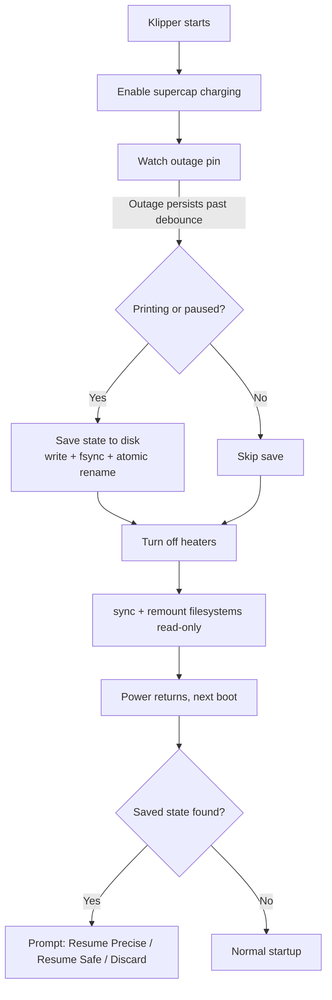

# power_loss — Power Loss Recovery for Elegoo Centauri Carbon (COSMOS)

A Klipper extras module that detects a real mains power outage using the Centauri Carbon's hardware supercapacitor, saves the state of the print in progress, and lets you resume it once power returns.

| Model | Status |
| --- | --- |
| Centauri Carbon 1 (CC1) | Built-in defaults (`printer_model: cc1`). |
| Centauri Carbon 2 (CC2) | Defaults from Elegoo's official config (`printer_model: cc2`), **not yet confirmed on a running printer**. See [Centauri Carbon 2](#centauri-carbon-2). |

> \[!WARNING\] This module is experimental and has not been validated across printers or hardware revisions. Test it with a print you don't care about before relying on it. See [Known limitations](#known-limitations).

## Table of contents

- [How it works](#how-it-works)
- [Hardware](#hardware)
- [Centauri Carbon 2](#centauri-carbon-2)
- [Installation](#installation)
- [Configuration](#configuration)
- [Commands](#commands)
- [Detection methods](#detection-methods)
- [Resume sequence](#resume-sequence)
- [Known limitations](#known-limitations)
- [Troubleshooting](#troubleshooting)
- [Credits and license](#credits-and-license)

## How it works



1. **Charges** the supercapacitor when Klipper becomes ready.
2. **Detects** an outage on a dedicated GPIO pin, using edge events with a polling fallback, and debounces it so a brief flicker doesn't trigger a save.
3. **Saves** position, temperatures, fan, speed and file offset to disk. This only happens if a print is running or paused.
4. **Protects** the filesystems by running `sync` and remounting writable ext\*/FAT mounts read-only. It does not shut the system down.
5. **Offers a resume** on the next boot through a Mainsail/Fluidd prompt.

## Hardware

Pins for each model (the `printer_model` defaults):

| Function | CC1 port | CC1 GPIO | CC2 port | CC2 GPIO | Used by this module |
| --- | --- | --- | --- | --- | --- |
| Outage detection | PG0 | 192 | PG9 | 201 | Input (read) |
| Supercap charge enable | PC1 | 65 | PD20 | 116 | Output (control) |
| Supercap output to power rail | PG11 | 203 | PG11 | 203 | **Never used** |

Linux GPIO numbers use the Allwinner rule `32 × (port letter index, A=0) + pin`. That reproduces all three CC1 numbers, and the CC2 numbers are derived the same way. The CC2 port names come from the `[por]` section of Elegoo's `printer_dsp.cfg`.

> \[!IMPORTANT\] The "supercap output to rail" line connects the supercap to the power rail. The module refuses to start if the configured `rail_gpio` is also used as the sensor or charge pin. On both CC1 and CC2 that is GPIO 203 and is guarded by default. Don't remove that guard without checking with a multimeter what is on the other side.

Reported behavior from a real outage test on a CC1: with the supercap charged, the SoC stayed alive for roughly 5–15 seconds. Whether motors and heaters keep any residual power is **unconfirmed**, so the module assumes they don't and only moves the toolhead on resume.

## Centauri Carbon 2

With `printer_model: cc2` the module uses these defaults:

```ini
[power_loss]
printer_model: cc2
sensor_gpio: 201      # PG9
charge_gpio: 116      # PD20
rail_gpio: 203        # PG11, guarded and never driven
```

**Where the numbers come from.** Elegoo's official CC2 config (`debugfile/printer_dsp.cfg` in `elegooofficial/CentauriCarbon2`) has a `[por]` section with `sensor_pin=host:PG9`, `ctrl_pin=host:PG11`, `charge_pin=host:PD20` and `charge_time=30.0`. The same pin table was posted in [OpenCentauri/cosmos issue 348](https://github.com/OpenCentauri/cosmos/issues/348). The conversion to Linux GPIO numbers uses the standard Allwinner formula, which matches the CC1's known values. It assumes the CC2 uses the same SoC pin numbering, which I haven't confirmed on a running CC2.

> \[!WARNING\] The CC2 numbers are derived, not measured. On startup the module logs a warning for `cc2`. Before trusting a save:
> 
> 1. Run `POWER_LOSS_STATUS` and `cat /sys/kernel/debug/gpio` (if debugfs is mounted) and check that the lines are named or behave as expected.
> 2. Run `POWER_LOSS_TEST_READ N=100` with mains on. If the readings are all `1`, the sensor polarity is probably opposite to the CC1 and you need `invert_sensor: True`. The official config does not state the polarity.
> 3. Only then do a controlled test with a print you don't care about.

Differences from `cc1`:

- **No tray macro or wipe by default.** `tray_macro` is blank and the built-in wipe pattern is disabled. The wipe uses CC1 coordinates, so it is rejected for any model other than `cc1`. If `tray_macro` is blank, the resume skips the purge entirely rather than purging over the part. Point `tray_macro` at your own parking macro if you want a purge.
- **Re-check `homing_override_z_lift`.** It must match the Z lift in your CC2's `[homing_override]`.
- **It is unconfirmed that your CC2 firmware has the sysfs GPIO access this module needs.** Elegoo's CC2 config shows a different architecture from the CC1 (a separate DSP core running the motion MCU), and I haven't confirmed that the CC2 runs COSMOS and a Klipper host that can load `extras` modules.

Use `printer_model: custom` for any other board. It has no GPIO defaults, so you must set `sensor_gpio` and `charge_gpio` yourself, and `rail_gpio` too so the rail line is guarded.

If you confirm the CC2 behavior on real hardware (or find that a number is wrong), please open an issue or PR so the defaults can be corrected.

## Installation

COSMOS's root filesystem is read-only, so the module is installed through an overlay mount over Klipper's `extras` directory. The installer does this for you. Run it on the printer as root.

### One-line install

Replace `OWNER/REPO` with this repository, and pin a tag or commit instead of `main` if you can:

```sh
curl -fsSL https://raw.githubusercontent.com/peepsnet/CentauriCarbon-1-2-PowerLoss-Script/main/install.sh | sh
```

To pass options, use `sh -s --`:

```sh
curl -fsSL https://raw.githubusercontent.com/peepsnet/CentauriCarbon-1-2-PowerLoss-Script/main/install.sh | sh -s -- --model cc2
```

> \[!NOTE\] Piping a script into `sh` runs whatever is at that URL. If you'd rather read it first, download `install.sh`, open it, then run `sh install.sh`. The installer only needs `curl` or `wget`.


### What the installer does

1. **Checks** that it's running as root, that the Klipper `extras` directory exists, and that the kernel supports overlayfs.
2. **Identifies your printer.** It looks at system identification strings (device-tree model, hostname, OS release) and, as a weaker signal, at printer configs that reference a DSP rpmsg MCU (CC2 style). It always shows what it found and asks you to confirm. If it can't tell, it shows a menu: CC1, CC2 or custom. For a custom board it asks for the three GPIO numbers.
3. **Downloads** `power_loss.py`, checks that it looks like the module and compiles, and verifies a SHA-256 if you supplied one.
4. **Copies** it into `/data/klipper-extras-upper` and mounts the overlay.
5. **Persists the mount** by adding a marked block to `/etc/init.d/klipper`, after backing it up to `/etc/init.d/klipper.bak-power_loss`. If it can't find a `start)` block, it leaves the file alone and prints the block for you to add.
6. **Prints the `[power_loss]` section** for your model, or appends it to a file you name with `--printer-cfg`, after backing that file up.

It never restarts Klipper, because that would interrupt a print. Restart it yourself when the printer is idle.

> \[!IMPORTANT\] Detection is a best guess and I haven't verified the identification strings on real CC1 or CC2 units. That's why it always asks for confirmation. Check the model it picks before you accept it.

### Options

| Option | Description |
| --- | --- |
| `--model cc1\|cc2\|custom` | Skip detection and prompts. |
| `--sensor N --charge N --rail N` | Linux GPIO numbers for `--model custom`. The rail line is guarded and never driven. |
| `--printer-cfg PATH` | Append the `[power_loss]` section to this file. It is skipped if the file already has one. |
| `--yes`, `-y` | Accept the detected model without asking. It fails if nothing could be detected. |
| `--no-persist` | Don't patch the init script. The mount then lasts until the next reboot. |
| `--uninstall` | Remove the module, the init patch and the overlay. The saved state file and your `printer.cfg` are left alone. |
| `--no-mount` | Copy and patch files only, with no mount and no root check. Intended for testing. |

| Environment variable | Description |
| --- | --- |
| `POWER_LOSS_REPO` | `owner/name` of the GitHub repository to download from. |
| `POWER_LOSS_REF` | Branch, tag or commit to download. Defaults to `main`. |
| `POWER_LOSS_SHA256` | Require this checksum for `power_loss.py`. |

Non-interactive example (for example over SSH with no terminal), using a pinned tag and a checksum:

```sh
curl -fsSL https://raw.githubusercontent.com/OWNER/REPO/v1.0.0/install.sh | \
  POWER_LOSS_REPO=OWNER/REPO POWER_LOSS_REF=v1.0.0 POWER_LOSS_SHA256=<sha256> \
  sh -s -- --model cc1 --printer-cfg /path/to/printer.cfg
```

> \[!NOTE\] A COSMOS update may overwrite `/etc/init.d/klipper`. Check it after every update and re-run the installer if the block is gone. Re-running is safe: every step skips what is already done.

### Manual install

If you'd rather not use the script:

```sh
mkdir -p /data/klipper-extras-upper /data/klipper-extras-work
cp power_loss.py /data/klipper-extras-upper/power_loss.py

mount -t overlay klipper-extras-overlay \
    -o lowerdir=/usr/share/klipper/klippy/extras,upperdir=/data/klipper-extras-upper,workdir=/data/klipper-extras-work \
    /usr/share/klipper/klippy/extras
```

To make it permanent, add this inside the `start)` block of `/etc/init.d/klipper`, before the `start-stop-daemon` line:

```sh
if ! grep -q '^klipper-extras-overlay ' /proc/mounts; then
    mount -t overlay klipper-extras-overlay \
        -o lowerdir=/usr/share/klipper/klippy/extras,upperdir=/data/klipper-extras-upper,workdir=/data/klipper-extras-work \
        /usr/share/klipper/klippy/extras
fi
```

### Enable and verify

Add a `[power_loss]` section to `printer.cfg` (the installer prints one for your model; see [Configuration](#configuration)), then restart Klipper while no print is running:

```sh
service klipper restart
```

In the Mainsail/Fluidd console run:

```
POWER_LOSS_STATUS
```

After about 30 seconds it should report `charge_done=True` and show which `detection=` method is active.

### Uninstall

```sh
sh install.sh --uninstall
```

## Configuration

Every option has a default on `cc1`. `cc2` has pin defaults from Elegoo's config, and `custom` has none, so you must set the GPIO options. Only declare the options you want to change.

```ini
[power_loss]
printer_model: cc1
sensor_gpio: 192
charge_gpio: 65
rail_gpio: 203
poll_interval: 0.01
debounce_time: 0.05
charge_time: 30
save_path: /data/power_loss_state.json
z_hop: 10.0
travel_speed: 3000
homing_override_z_lift: 5.0
purge_mm: 15.0
move_temp: 200.0
tray_macro: MOVE_TO_TRAY
wipe: True
#invert_sensor: False
```

| Option | Default | Description |
| --- | --- | --- |
| `printer_model` | `cc1` | `cc1`, `cc2` or `custom`. Selects the defaults below. `custom` has no GPIO defaults. |
| `sensor_gpio` | `192` on `cc1`, `201` on `cc2`, required on `custom` | Linux GPIO for outage detection. |
| `charge_gpio` | `65` on `cc1`, `116` on `cc2`, required on `custom` | Linux GPIO that enables supercap charging. |
| `rail_gpio` | `203` on `cc1` and `cc2`, none on `custom` | Supercap output-to-rail line. Never driven. Startup fails if it matches the sensor or charge pin. |
| `poll_interval` | `0.01` | Seconds between reads when using the polling fallback. |
| `debounce_time` | `0.05` | Seconds an outage must persist before it counts. Filters electrical noise and flickers. |
| `charge_time` | `30` | Seconds the supercap is assumed to need to charge. Reported by `POWER_LOSS_STATUS`. |
| `save_path` | `/data/power_loss_state.json` | Where the state file is written. Must be on a writable partition. |
| `z_hop` | `10.0` | Safety lift (mm) before homing X/Y on resume. |
| `travel_speed` | `3000` | Speed (mm/min) for hop and travel moves on resume. |
| `homing_override_z_lift` | `5.0` | Must match the `G0 Z<N>` lift in your `[homing_override]` macro. See [limitations](#known-limitations). |
| `purge_mm` | `15.0` | Filament purged at the tray before resuming, to clear ooze. |
| `move_temp` | `200.0` | Nozzle temperature to reach before any movement. The full target keeps heating in the background. |
| `tray_macro` | `MOVE_TO_TRAY` on `cc1`, blank otherwise | Macro that parks the toolhead at the purge tray. If blank, the purge and wipe are skipped. |
| `wipe` | `True` on `cc1`, `False` otherwise | Run the built-in tray wipe pattern (CC1 coordinates). Rejected on any model other than `cc1`. |
| `invert_sensor` | `False` | Set to `True` if the sensor polarity turns out to be inverted. |

## Commands

| Command | Description |
| --- | --- |
| `POWER_LOSS_STATUS` | Shows monitor status: pins, charge state, pending resume and the active detection method. |
| `POWER_LOSS_RESUME` | Resumes from the exact position at the moment of the outage. |
| `POWER_LOSS_RESUME_SAFE` | Resumes from the last completed layer. It repeats part of a layer but avoids resuming mid-move or mid-wipe. |
| `POWER_LOSS_DISCARD` | Deletes the saved state without resuming. |
| `POWER_LOSS_TEST_READ N=<n>` | Shows the last *n* sensor readings. It is non-blocking and safe to run mid-print. |

`POWER_LOSS_RESUME_SAFE` is the highlighted choice in the prompt. If the outage happened before the first layer change, it falls back to the precise capture automatically.

## Detection methods

The module tries these in order and falls back if one fails:

1. **Raw GPIO ioctl (v1 uAPI)** requests edge events on `/dev/gpiochip0` using only the Python standard library. It is interrupt-driven, so the reactor stays idle between events.
2. **Sysfs polling** reads the pin every `poll_interval` seconds. It is the guaranteed fallback.

`POWER_LOSS_STATUS` reports which one is active, and the choice is also logged at startup.

> \[!NOTE\] A GPIO line has one exclusive owner in the kernel. The module requests the edge events *before* touching sysfs for this reason. If you export GPIO 192 manually while Klipper is running, the ioctl tier will fail with `EBUSY` and the module will fall back to polling.

In edge mode, the pin level is re-read after `debounce_time` to confirm the outage. If that read fails, the module trusts the edge and saves anyway, so it errs toward saving.

## Resume sequence

When you choose a resume option, the module does the following:

1. **Heats the nozzle** to `move_temp` (the bed and full nozzle target keep heating in the background) so a nozzle stuck to the part can release.
2. **Marks Z** at the saved height and hops up by `z_hop`.
3. **Homes X/Y** with a real `G28 X Y`. This avoids trusting a saved XY position that may be off by several mm due to motion lookahead.
4. **Corrects Z** for the `[homing_override]` lift: it re-declares Z as `saved_z + z_hop + homing_override_z_lift`.
5. **Waits for full temperatures**, then runs `tray_macro` (default `MOVE_TO_TRAY` on `cc1`), purges `purge_mm` of filament and runs the wipe pattern. If no `tray_macro` is set, this step is skipped entirely.
6. **Travels** to the saved X/Y while still elevated, then lowers to the saved Z.
7. **Restores extruder state** by replaying the G-code file up to the resume offset to find the extrude mode (`M82`/`M83`) and last `E` value. It does not trust Klipper's live state. Fan and speed factor are also restored.
8. **Reloads the file** with `M23`, `M26` and `M24`, and deletes the state file.

The state file contains two position packages: `instant` (captured at the outage) and `checkpoint` (captured at the last layer change). Each package is only ever used as a whole. The module never mixes position and file offset from different packages.

## Known limitations

- **`homing_override_z_lift` is printer-specific.** The Z correction assumes a real `G0 Z<N>` inside your `[homing_override]` macro. If you change that macro, this value becomes silently wrong.
- **The wipe pattern and `MOVE_TO_TRAY` are CC1 specific.** The wipe coordinates are hardcoded, so the module only allows `wipe: True` with `printer_model: cc1`. Set `wipe: False` to skip it, or use `tray_macro` for your own sequence.
- **Motor and heater power during an outage is unconfirmed.** The module assumes there is none and doesn't attempt an emergency retract or Z hop at outage time.
- **A brief outage still runs the full flow.** Debounce filters noise and sub-`debounce_time` flickers, but any outage longer than that triggers the save and filesystem protection even if power returns a moment later.
- **The resume leaves a visible seam** where the print continues. This is inherent to this kind of recovery.
- **The debounce re-read ioctl is unverified** on this kernel. If it fails, the module saves on the edge alone.
- **CC2 support is untested.** The CC2 pin numbers come from Elegoo's config via a standard conversion, and I couldn't confirm them, the sensor polarity, or that the CC2 runs COSMOS/Klipper with sysfs GPIO access on real hardware. The CC1 defaults come from known hardware, and even those have only had limited testing.

## Troubleshooting

| Symptom | Check |
| --- | --- |
| `Unknown command: POWER_LOSS_STATUS` | The overlay isn't mounted or Klipper wasn't restarted. Run `ls /usr/share/klipper/klippy/extras/power_loss.py`. |
| `detection=polling` | The ioctl tier failed. Check `klippy.log` for the reason, for example `EBUSY` if something else owns GPIO 192. |
| Resume prompt never appears | The prompt is retried for about 20 seconds after boot. Run `POWER_LOSS_RESUME_SAFE` manually. |
| Startup error: `no verified default GPIOs` | You set `printer_model: custom` without `sensor_gpio` and `charge_gpio`. Set them explicitly. |
| Z height wrong after resume | Verify `homing_override_z_lift` against your `[homing_override]` macro. The console prints the declared Z. |
| Save never triggers | Try `invert_sensor: True`, and watch readings with `POWER_LOSS_TEST_READ N=100`. |
| State file not written | Confirm `save_path` is on a writable partition. |

## Credits and license

This module's design is based on the public work of others:

- **Elegoo's official firmware** (`por.cpp`, `virtual_sdcard.cpp`, `break_save.cpp`, `gpio.h`), GPL-3.0, for the detection mechanism, saved-state fields and GPIO pin numbers, and the CC2 `printer_dsp.cfg` `[por]` section for the CC2 pins.
- **[KlipperPLR](https://github.com/bigtreetech/KlipperPLR)** (BigTreeTech, forked from Yumi-Lab/Yumi_PLR) for deriving extrude mode and the last `E` value by replaying the G-code file.
- **[docs.opencentauri.cc](https://docs.opencentauri.cc)** for hardware and architecture documentation.
- The original community implementation of Power Loss Recovery for the Centauri Carbon, which this module follows in structure and behavior.

Because the design derives from GPL-3.0 sources, distribute this module under the **GPL-3.0** license for consistency.
